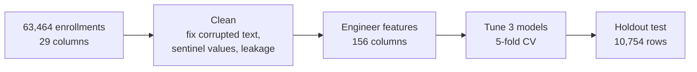
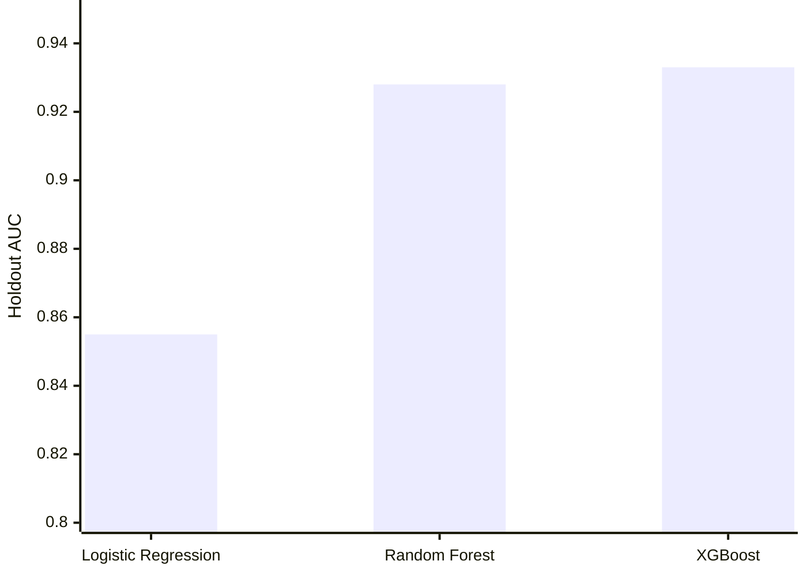
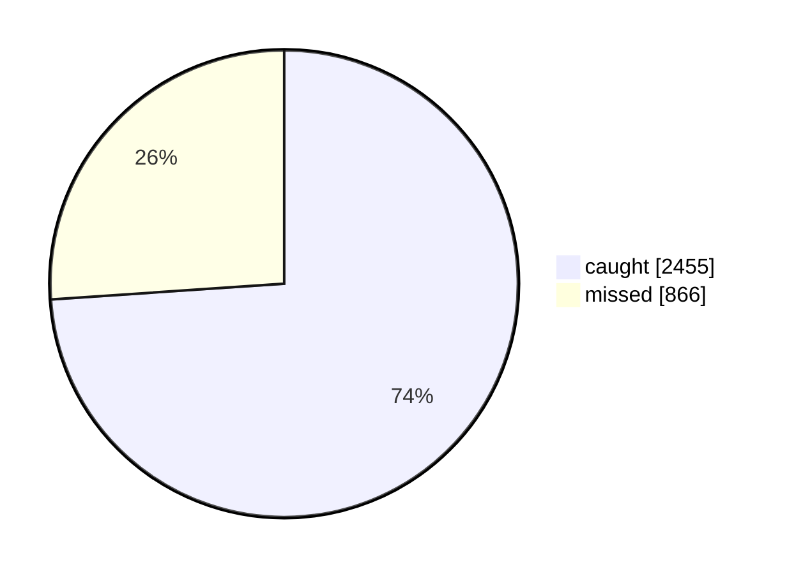
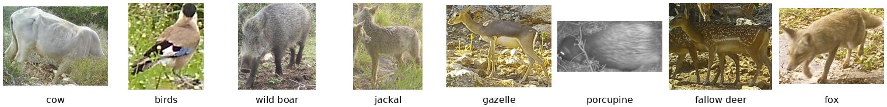
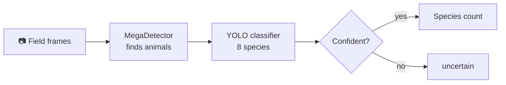

# Predict-Dropout

Two machine-learning projects.

| | Project | Data | Model |
|---|---|---|---|
| 🎓 | [Course-dropout prediction](#-course-dropout-prediction) | 63,464 enrollments | XGBoost |
| 🦌 | [Camera-trap species detection](#-camera-trap-species-detection) | 2,500 labelled crops + 2,423 field frames | YOLO + MegaDetector |

---

## 🎓 Course-dropout prediction

**Can we flag which enrollments will drop a course, early enough to intervene?**

**Which model wins?** Holdout AUC, where 1.0 is perfect:

**XGBoost on the holdout's 3,321 real dropouts:**

Of the enrollments it flags, 82% really do drop. The strongest predictors are a previous dropout, origin country, and open support tickets.

📄 Details: [`extra/EXECUTIVE_SUMMARY.md`](extra/EXECUTIVE_SUMMARY.md)

---

## 🦌 Camera-trap species detection

**Which animals pass the camera traps, and do jackals outnumber gazelles?**

The model gets 96.6% of test images right and never confuses gazelle with jackal. In the May 2022 field data, jackal (18 crops) outnumbers gazelle (13).

📓 Notebook: [`Yotam_Eviatar_final_assignment.ipynb`](Yotam_Eviatar_final_assignment.ipynb) · 🧹 Clean version: [Detect-Species](https://github.com/YotamEviatar-stu/Detect-Species)
