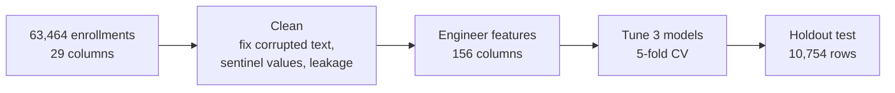
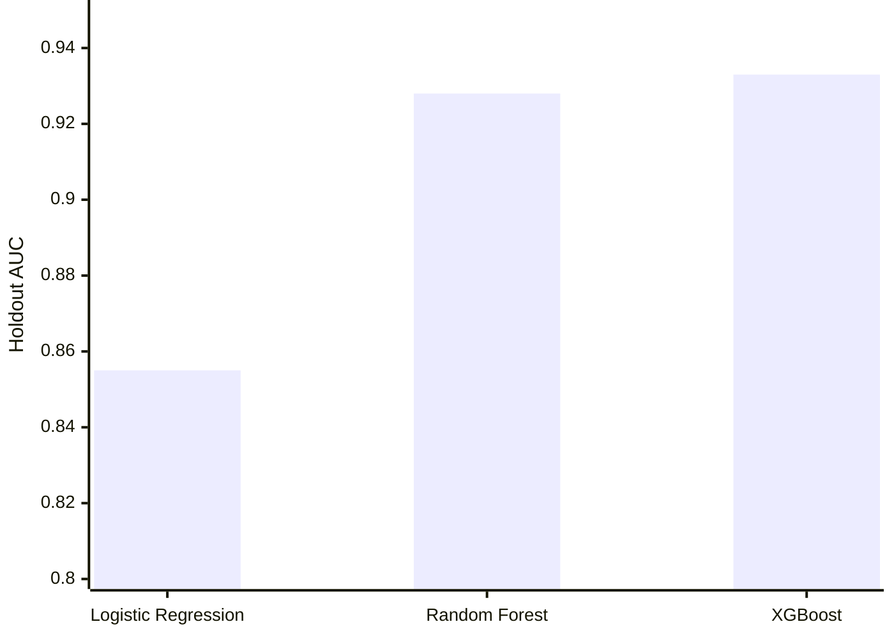
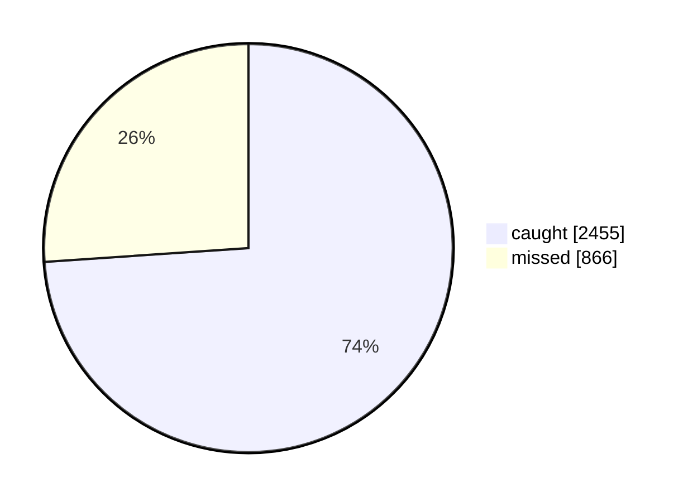

# Predict-Dropout

**Can we flag which enrollments will drop a course, early enough to intervene?**

**Which model wins?** Holdout AUC, where 1.0 is perfect:

**XGBoost on the holdout's 3,321 real dropouts:**

Of the enrollments it flags, 82% really do drop. The strongest predictors are a previous dropout, open support tickets, and origin country. Origin country partly stands in for client industry, because Portuguese clients skew toward Big Tech and IT.

📄 Details: [`extra/EXECUTIVE_SUMMARY.md`](extra/EXECUTIVE_SUMMARY.md)

---
The camera-trap notebook in this repo has its own clean version: [Detect-Species](https://github.com/YotamEviatar-stu/Detect-Species).
