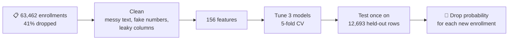
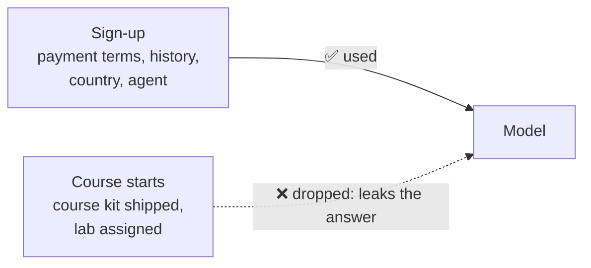
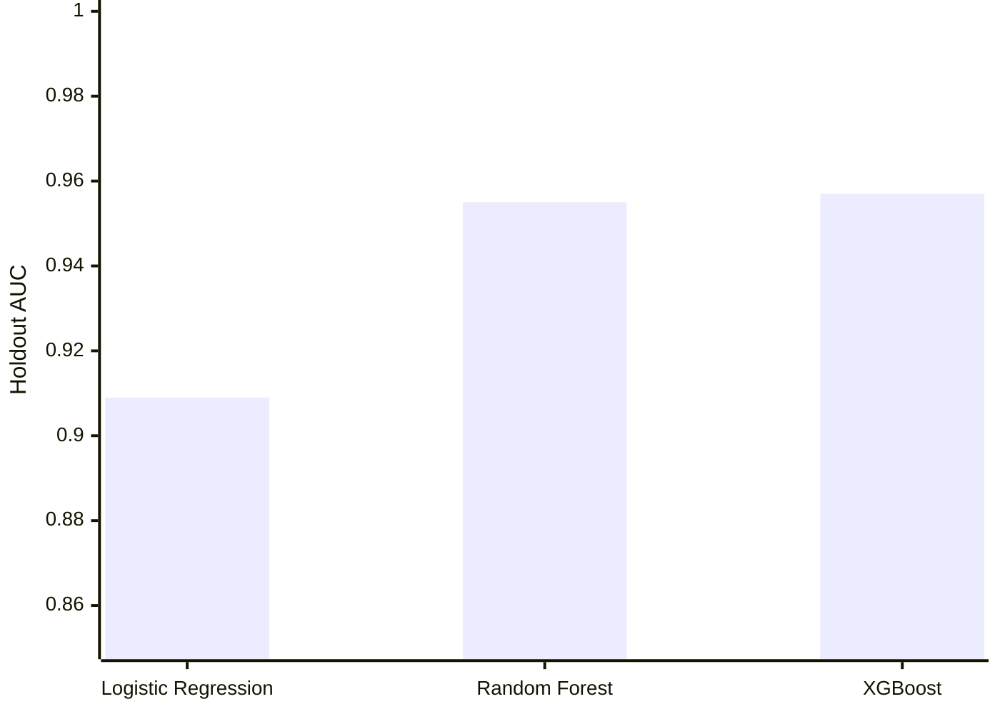
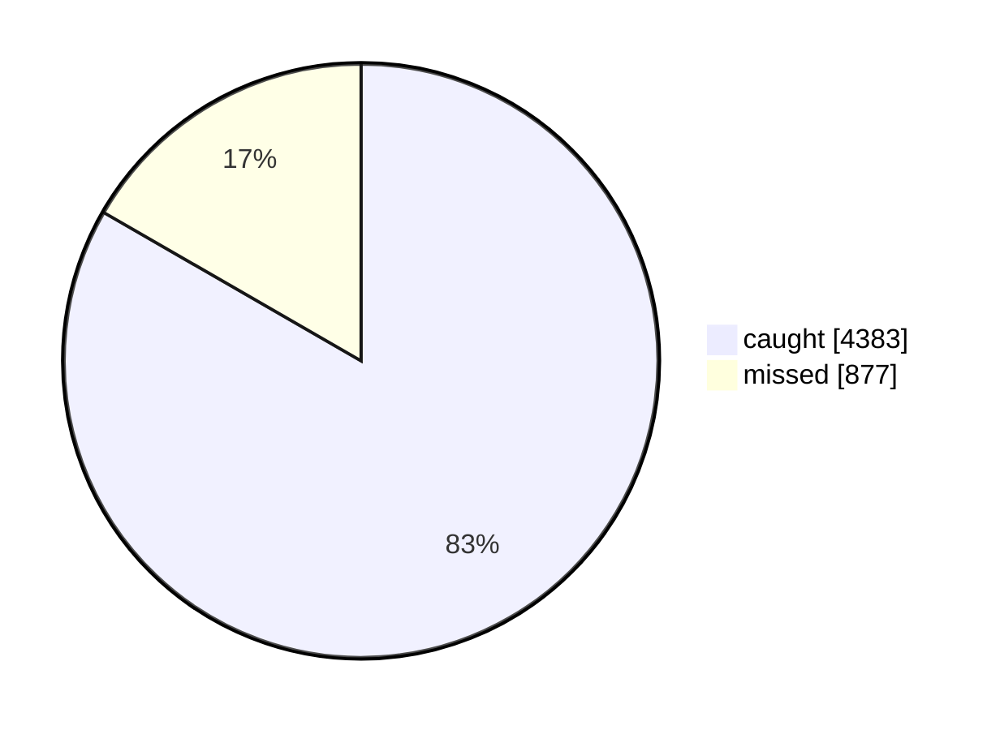

# Predict-Dropout

**Which course enrollments will be dropped, and can we flag them early enough to call the client first?**

## What predicts a dropout

## Three problems the pipeline handles

**1. Messy text.** Category values were typed by hand, so one client type appears in 141 different spellings. Upper-casing and stripping symbols collapses them.

**2. Fake numbers.** Some values are impossible, such as 9,999 students or −5 practical hours. They mark missing data, so they're treated as missing and filled with the median.

**3. Columns that leak the answer.** Only data known at sign-up can be used. Some columns are filled in only after the client shows up, which gives the answer away.

## Results

**Which model is best?** Holdout AUC (1.0 = perfect ranking):

**XGBoost on the 5,260 real dropouts in the holdout:**

When it flags an enrollment, it's right 89% of the time (562 false alarms).

**What the model looks at:**

Origin country PRT ranks high partly because it stands in for client type. Clients from PRT are mostly Big Tech and IT (66%), while other clients are mostly SaaS (66%).

---
Code: [`pipeline.py`](pipeline.py), five steps that read top to bottom. Run it with `pip install -r requirements.txt && python pipeline.py`. The data is in [`data/`](data/).
