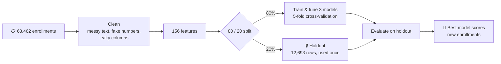
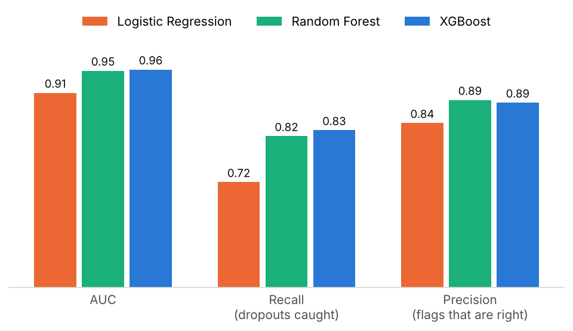
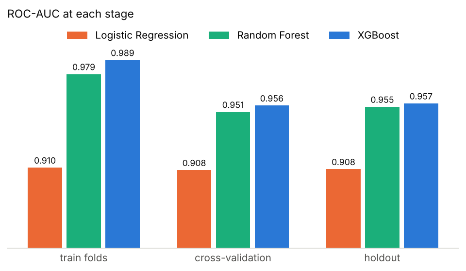
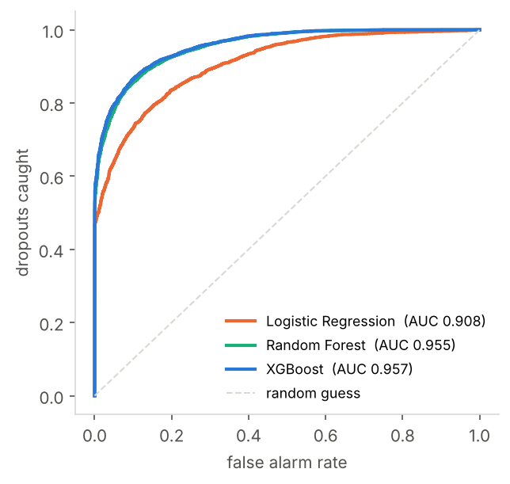
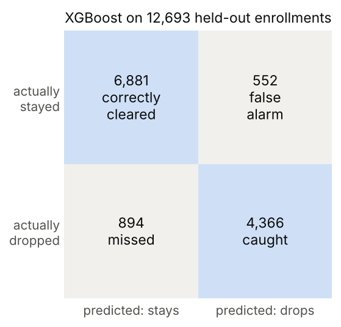
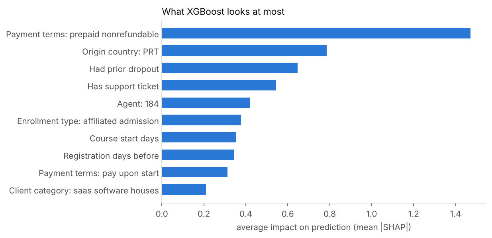

# Predict-Dropout

## Background

We were asked to train and validate a model that predicts which B2B course enrollments will be **dropped**, so the client can be contacted before they cancel. The data covers 63,464 past enrollments with 29 columns each; 41% of them dropped.

## How it works

## Model performance

Three models were compared: logistic regression, random forest and XGBoost.

**Does it generalise?** Cross-validation and holdout scores match, so the score holds up on data the model never saw. The tree models fit their training folds more closely, but that doesn't cost them on new data.

<table>
<tr>
<td></td>
<td></td>
</tr>
<tr>
<td align="center">Every model ranks dropouts far above chance</td>
<td align="center">XGBoost catches 83% of dropouts; 89% of its flags are right</td>
</tr>
</table>

**Chosen model: XGBoost.** It has the highest AUC (0.957) and recall (0.83). Recall matters most here: a missed dropout means nobody calls the client, while a false alarm only costs one unnecessary call.

## What the model looks at

Origin country PRT ranks high partly because it stands in for client type: PRT clients are mostly Big Tech and IT (66%), while other clients are mostly SaaS (66%).

---
Code: [`pipeline.py`](pipeline.py), five annotated steps covering cleaning, features, training, evaluation and scoring. Run it with `pip install -r requirements.txt && python pipeline.py`; the data is in [`data/`](data/).
